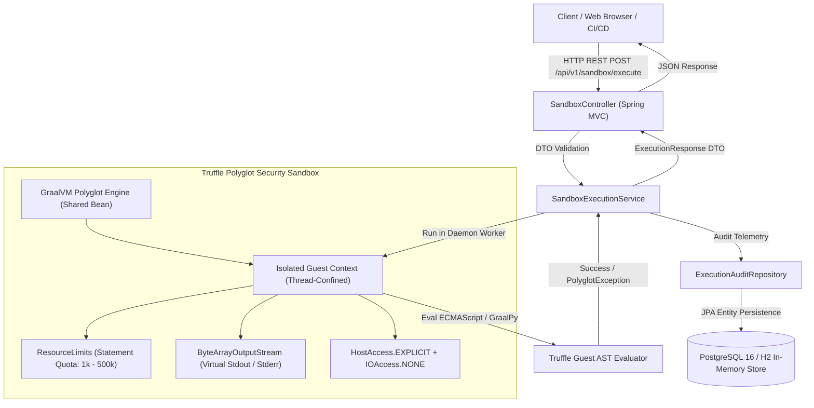

# PolyglotMesh: GraalVM Multi-Language Runtime Sandbox
**Enterprise In-Memory Guest Code Execution Engine with Hardware-Level Isolation & Statement-Level Quotas**

---

### Project Metadata
- **Project Ref No:** ITS/JD/1327
- **Candidate / Intern:** Ganesh Chakravarthula
- **Email:** [ganeshvarma493@gmail.com](mailto:ganeshvarma493@gmail.com) | **Phone:** +91 9391761912
- **Organization:** Infotact Solutions, Electronic City, Bengaluru
- **Role:** Associate L1. Intern (Java Development)
- **Technology Stack:** Java 21/26, Spring Boot 3.3.5, Oracle GraalVM Truffle Polyglot Engine 24.1.1, PostgreSQL 16 / H2, Docker & Docker Compose, HTML5/CSS3/JavaScript SPA.

---

## 1. Executive Summary

**PolyglotMesh** is an enterprise-grade multi-language execution platform that allows client applications to safely evaluate untrusted guest scripts (**JavaScript ECMAScript 2023** and **Python 3.11+ via GraalPy**) in-process within a shared Java Virtual Machine. By leveraging Oracle's GraalVM Truffle Polyglot framework, PolyglotMesh achieves native execution performance while guaranteeing total sandboxing through **Four Defensive Security Layers**:

1. **Host Access Lockdown (`HostAccess.EXPLICIT`):** Zero access to Java classes, System reflection, classloaders, or host memory unless explicitly annotated with `@HostAccess.Export`.
2. **I/O & Socket Virtualization (`IOAccess.NONE`):** Guest scripts cannot access the host filesystem, open network sockets, bind ports, or read host environment variables.
3. **Instruction Quota Limiting (`ResourceLimits.statementLimit`):** Hard caps on the number of Truffle Abstract Syntax Tree (AST) statements executed, killing algorithmic complexity and infinite-loop DoS attacks within milliseconds.
4. **Daemon Watchdog Execution (`CompletableFuture` + Timers):** Thread-level timeout monitors forcefully terminate contexts that exceed execution deadlines.

Every script evaluation—whether successful, terminated, or rejected—is logged to a persistent **PostgreSQL audit store** with precise execution metrics, source code hashes, and error diagnostics.

---

## 2. High-Level Architecture



---

## 3. Project Structure

```
PolyglotMesh/
├── src/
│   ├── main/
│   │   ├── java/com/infotact/polyglotmesh/
│   │   │   ├── config/
│   │   │   │   └── PolyglotConfig.java        # Shared GraalVM Engine & HostAccess beans
│   │   │   ├── controller/
│   │   │   │   └── SandboxController.java     # REST API endpoints & Web UI mapping
│   │   │   ├── dto/
│   │   │   │   ├── ExecutionRequest.java      # Validated Record DTO for script payload
│   │   │   │   ├── ExecutionResponse.java     # Telemetry & result Record DTO
│   │   │   │   └── SupportedLanguage.java     # Enum mapping 'js' and 'python'
│   │   │   ├── entity/
│   │   │   │   └── ExecutionAuditLog.java      # JPA entity for execution audit trail
│   │   │   ├── exception/
│   │   │   │   └── GlobalExceptionHandler.java # Error translation to HTTP 400 / 422 JSON
│   │   │   ├── repository/
│   │   │   │   └── ExecutionAuditRepository.java # Spring Data JPA repository
│   │   │   ├── service/
│   │   │   │   └── SandboxExecutionService.java  # Polyglot sandbox coordinator
│   │   │   └── PolyglotMeshApplication.java   # Spring Boot Application entrypoint
│   │   └── resources/
│   │       ├── static/
│   │       │   └── index.html                 # Interactive Developer Console SPA
│   │       ├── application.properties         # Production PostgreSQL config
│   │       └── application-h2.properties      # Zero-setup local H2 config
│   └── test/
│       ├── java/com/infotact/polyglotmesh/    # Comprehensive unit and integration tests
│       └── resources/
│           └── application.properties         # Test profile configuration
├── docs/
│   ├── PROJECT_REPORT.md                      # Formal technical internship report
│   ├── PRESENTATION.md                        # Presentation slide deck outline
│   ├── presentation.html                      # Interactive slide deck presentation
│   └── BENCHMARK_RESULTS.md                   # Empirical benchmark and security audit data
├── Dockerfile                                 # Multi-stage container build
├── docker-compose.yml                         # Containerized Spring Boot + PostgreSQL setup
├── mvnw.cmd                                   # Maven wrapper for local builds
├── run.bat                                    # One-click Windows startup script
├── verify-endpoints.ps1                       # Automated API verification test suite
└── pom.xml                                    # Maven dependencies & plugins
```

---

## 4. Prerequisites & Requirements

| Component | Minimum Version | Recommended Version |
| :--- | :--- | :--- |
| **Java Development Kit (JDK)** | JDK 21 (LTS) | GraalVM JDK 21 or OpenJDK 21+ |
| **Apache Maven** | 3.8.0+ | 3.9.6+ (bundled wrapper available) |
| **Database (Optional for local)** | PostgreSQL 14+ | PostgreSQL 16 (or built-in H2) |
| **Container Engine (Optional)** | Docker 20.10+ | Docker Desktop with Compose v2 |
| **Modern Web Browser** | Chrome 110+, Edge 110+, Firefox 110+ | Any Chromium-based browser |

---

## 5. Quick Start (Running the Application)

### Option A: One-Click Local Run (In-Memory H2 Mode — Zero Setup)
No database installation required! Double-click `run.bat` or run:
```cmd
.\run.bat
```
Or via Maven command line:
```bash
.\mvnw.cmd spring-boot:run -Dspring-boot.run.profiles=h2
```
Once started:
- **Developer Web Console:** [http://localhost:8080](http://localhost:8080)
- **H2 Web Console:** [http://localhost:8080/h2-console](http://localhost:8080/h2-console) (JDBC URL: `jdbc:h2:mem:polyglotmesh`, User: `sa`, Password: *blank*)
- **Health Actuator:** [http://localhost:8080/actuator/health](http://localhost:8080/actuator/health)

---

### Option B: Production Mode with Docker Compose (PostgreSQL 16)
To launch the complete production stack (PostgreSQL database + PolyglotMesh container):
```bash
docker compose up --build -d
```
To monitor startup logs:
```bash
docker compose logs -f polyglotmesh-app
```
To tear down:
```bash
docker compose down -v
```

---

## 6. How the Frontend Developer Console Works

The frontend console (`src/main/resources/static/index.html`) is served directly by Spring Boot at `http://localhost:8080/`. It provides a developer-friendly workbench to test, benchmark, and monitor multi-language execution in real time:

```
+-----------------------------------------------------------------------------------+
|  [P] PolyglotMesh Console    | Ref: ITS/JD/1327 | GraalVM Truffle   [SYSTEM HEALTHY] |
+-----------------------------------------------------------------------------------+
|  PRESETS: [JS Math] [Python Squares] [Security Escape] [Infinite Loop] [Bindings]   |
+-----------------------------------------+-----------------------------------------+
|  CODE EDITOR & SANDBOX CONFIG           |  REAL-TIME TELEMETRY & OUTPUT           |
|                                         |                                         |
|  Language: [JavaScript (ES2023)  v]     |  [ID: #1]  [Dur: 42ms]  [Status: OK]    |
|  Statements Quota: [50,000        ]     +-----------------------------------------+
|  Watchdog Timeout: [3,000 ms      ]     |  Tabs: [Return Value] [Stdout] [Raw JSON|
|                                         |                                         |
|  // Source Code:                        |  Output Stream View:                    |
|  const arr = [10, 20, 30];              |  "60"                                   |
|  arr.reduce((a, b) => a + b, 0);        |                                         |
|                                         |                                         |
|  [x] Host Variable Bindings (JSON)      |                                         |
|  [ ⚡ Execute in Sandbox (Ctrl+Enter) ] |                                         |
+-----------------------------------------+-----------------------------------------+
|  AUDIT LOG PERSISTENCE (PostgreSQL / JPA Store)                      [Refresh]   |
|  # | Language | Status  | Duration | Return Value Preview | Executed At | Action  |
|  1 | JS       | SUCCESS | 42 ms    | 60                   | 21:32:00    | [Load]  |
+-----------------------------------------------------------------------------------+
```

### Key Frontend Features:
1. **Interactive Presets:** One-click loader for 5 representative workloads:
   - **JS Math:** Functional Array pipeline computing sum of squares.
   - **Python Squares:** GraalPy list comprehension and `sum()` evaluation.
   - **Host Escape Simulation:** Exploits `Java.type("java.lang.System").exit(1)`, proving Truffle blocks unauthorized reflection.
   - **Infinite Loop DoS:** A `while(true)` loop that demonstrates statement quota interception at precisely 1,001 statements.
   - **Host Variable Bindings:** Demonstrates passing JSON key-values from the host into guest runtime variables (`user`, `factor`).
2. **Keyboard Shortcut:** Press **`Ctrl + Enter`** from anywhere inside the code editor to execute instantly.
3. **Four Telemetry Tabs:**
   - **Return Value:** Evaluated result returned by the last expression of the guest AST.
   - **Stdout Stream:** Captures all guest `console.log()` or `print()` calls in memory.
   - **Stderr Stream:** Captures any guest error stack traces.
   - **Raw JSON:** Full REST API JSON payload with microsecond precision and metadata.
4. **Audit Trail Table & Code Re-Loader:**
   - Automatically polls the `/api/v1/sandbox/history` endpoint after every run.
   - Displays database ID, Language, Status Badges, Duration, and Preview.
   - Clicking **[Load]** instantly restores that historical script into the code editor for immediate re-execution or debugging.

---

## 7. REST API Reference

### 1. Execute Guest Script
- **Endpoint:** `POST /api/v1/sandbox/execute`
- **Content-Type:** `application/json`

#### Request Payload
```json
{
  "language": "js",
  "code": "const list = [1, 2, 3, 4, 5]; console.log('Multiplying by factor:', factor); list.map(n => n * factor).reduce((a, b) => a + b, 0);",
  "maxStatements": 50000,
  "timeoutMs": 3000,
  "bindings": {
    "factor": 10
  }
}
```

#### Successful Response (`HTTP 200 OK`)
```json
{
  "executionId": 1,
  "language": "js",
  "status": "SUCCESS",
  "returnValue": "150",
  "stdout": "Multiplying by factor: 10\n",
  "stderr": "",
  "durationMs": 42,
  "executedAt": "2026-11-11T21:30:00.123456",
  "maxStatementsApplied": 50000,
  "timeoutMsApplied": 3000,
  "errorMessage": null
}
```

#### Denial-of-Service Interception (`HTTP 200 OK` with Status Code)
```json
{
  "executionId": 2,
  "language": "js",
  "status": "RESOURCE_LIMIT",
  "returnValue": null,
  "stdout": "Loop started...\n",
  "stderr": "",
  "durationMs": 35,
  "executedAt": "2026-11-11T21:30:15.987654",
  "maxStatementsApplied": 1000,
  "timeoutMsApplied": 3000,
  "errorMessage": "Statement limit exceeded: 1001 > 1000 statements evaluated."
}
```

---

### 2. Retrieve Execution Audit History
- **Endpoint:** `GET /api/v1/sandbox/history`
- **Response:** Array of the latest 25 audited script executions stored in PostgreSQL / H2.

---

### 3. Query Supported Runtimes
- **Endpoint:** `GET /api/v1/sandbox/languages`
- **Response:**
```json
[
  {
    "id": "js",
    "displayName": "JavaScript (ECMAScript 2023 / Truffle JS)",
    "description": "Enterprise ECMAScript 2023 engine executed in-process on GraalVM."
  },
  {
    "id": "python",
    "displayName": "Python (GraalPy 3.11+)",
    "description": "GraalPy Python 3 runtime executed within an isolated Truffle Context."
  }
]
```

---

## 8. cURL Command Examples

#### Execute JavaScript Calculation:
```bash
curl -X POST http://localhost:8080/api/v1/sandbox/execute \
  -H "Content-Type: application/json" \
  -d "{\"language\":\"js\",\"code\":\"const x = 50; const y = 30; x * y;\"}"
```

#### Execute Python 3 Script:
```bash
curl -X POST http://localhost:8080/api/v1/sandbox/execute \
  -H "Content-Type: application/json" \
  -d "{\"language\":\"python\",\"code\":\"nums = [1, 2, 3, 4, 5]\nprint('Python list:', nums)\nsum(nums)\"}"
```

#### Test Sandbox Security Isolation (Blocked Reflection):
```bash
curl -X POST http://localhost:8080/api/v1/sandbox/execute \
  -H "Content-Type: application/json" \
  -d "{\"language\":\"js\",\"code\":\"Java.type('java.lang.System').exit(1);\"}"
```

---

## 9. Verification & Automated Testing

To run the automated endpoint validation suite on Windows:
```powershell
powershell -ExecutionPolicy Bypass -File .\verify-endpoints.ps1
```

The script performs automated end-to-end testing against 5 test suites:
1. **JavaScript Functional Execution with Variable Bindings** (Verifies calculation, stdout capture, and DTO parsing).
2. **Python 3 GraalPy In-Memory Computation** (Verifies GraalPy AST isolation).
3. **Denial-of-Service Quota Interception** (Verifies statement limiter halts execution at statement count + 1).
4. **Security Reflection Attack Prevention** (Verifies `HostAccess.EXPLICIT` rejects `java.lang.System.exit`).
5. **PostgreSQL/JPA Audit Log Verification** (Verifies chronological audit entries and field consistency).

---

## 10. Deliverables Checklist (Specification Ref: ITS/JD/1327)

- [x] **Deliverable 1: Source Code** — Clean OOP Spring Boot 3 architecture, GraalVM Polyglot API, Git tracking, `.gitignore`.
- [x] **Deliverable 2: Project Documentation** — Complete `README.md` with system prerequisites, Truffle architecture, setup guides, API reference, and Docker instructions.
- [x] **Deliverable 3: Technical Project Report** — Detailed formal report located at [`docs/PROJECT_REPORT.md`](file:///c:/Users/ganes/Desktop/Infotact%20Solutions%20project%202/PolyglotMesh%20GraalVM%20Multi-Language%20Runtime%20Sandbox/docs/PROJECT_REPORT.md).
- [x] **Deliverable 4: Presentation Deck** — High-impact 10-slide deck at [`docs/PRESENTATION.md`](file:///c:/Users/ganes/Desktop/Infotact%20Solutions%20project%202/PolyglotMesh%20GraalVM%20Multi-Language%20Runtime%20Sandbox/docs/PRESENTATION.md) and interactive HTML presentation at [`docs/presentation.html`](file:///c:/Users/ganes/Desktop/Infotact%20Solutions%20project%202/PolyglotMesh%20GraalVM%20Multi-Language%20Runtime%20Sandbox/docs/presentation.html).
- [x] **Deliverable 5: Benchmark & Security Audit Results** — Empirical benchmarks and 10-point security vector audit at [`docs/BENCHMARK_RESULTS.md`](file:///c:/Users/ganes/Desktop/Infotact%20Solutions%20project%202/PolyglotMesh%20GraalVM%20Multi-Language%20Runtime%20Sandbox/docs/BENCHMARK_RESULTS.md).
- [x] **Deliverable 6: Demonstration Walkthrough** — End-to-end frontend operational guide, UI anatomy, and code execution flow documentation.
